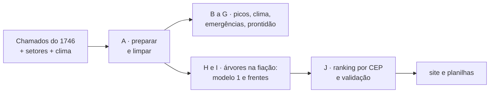

# Onde podar agora — Rio de Janeiro

Onde a poda de árvores é mais urgente no Rio, por que, e o que pode acontecer se não podar. Feito a partir dos chamados abertos da Central 1746 (set/2022 a set/2026).

Análise exploratória do projeto de extensão *Ciência de Dados para Cidades Inteligentes* (UFRJ). Não é um dado oficial da Prefeitura, da COMLURB nem da Light.

**Colaboradores:** [Heitor Morais](https://github.com/heitor-oss) e [José Salgado](https://github.com/jssppedra-png).

## O que tem neste repositório

| | |
|---|---|
| **[Site: Onde podar agora](https://heitor-oss.github.io/onde-podar-agora/)** | Os lugares prioritários, o motivo de cada um, o risco de não podar, mapa de risco e a lista completa de 9.848 CEPs, vistos um a um ou agrupados em áreas de 150 m. Feito para gestores. |
| **[Site: Painel 1746](https://heitor-oss.github.io/onde-podar-agora/painel-1746.html)** | Os chamados de poda do 1746 por bairro e por mês (2021 a 2025), ao lado da chuva dos pluviômetros do Alerta Rio. Filtros por período, tipo de chamado, zona, região, chuva e medida (total, por km² ou por habitante); mapa por bairro, rankings de bairros e ruas, quanto dos chamados vira poda e quanto tempo leva. |
| **[Outras análises](#outras-análises)** | Picos de chamados por CEP: quando e onde as árvores da cidade viram emergência. Também no site, como terceira aba. |
| **[Código da análise](codigo/)** | As 71 etapas em Python que vão dos CSVs do 1746 até o site: limpeza, modelos, validação. Comece pelo **[guia do código](codigo/README.md)**. |
| **[Documento: aprendizado de máquina no projeto](docs/aprendizado_de_maquina.md)** | Explicação didática dos três modelos usados, de como foram testados e do quanto dá para confiar neles. |
| **[Dados](dados/)** | O ranking completo por CEP, o ranking por área de 150 m e as quedas de árvore no verão por quadrado de 1 km, em CSV. |

## O código

Toda a análise pode ser refeita do zero. O código é uma sequência de etapas numeradas, cada uma com um cabeçalho em português dizendo o que faz, o que lê e o que grava:



Para rodar (com os CSVs dos chamados em `codigo/dados_entrada/`):

```
cd codigo
pip install -r requirements.txt
python rodar_tudo.py
```

Em 12 a 25 minutos, o site e as planilhas aparecem em `codigo/saidas/`. O **[guia do código](codigo/README.md)** explica passo a passo como rodar, como os dados foram limpos e filtrados, onde está cada modelo e o que tem em cada arquivo. A lista de todas as etapas está em **[codigo/ETAPAS.md](codigo/ETAPAS.md)**.

## O que o site mostra

O site tem três páginas, com abas no topo para trocar entre elas: **Onde podar agora** (abaixo), o **Painel 1746** e **Picos de chamados** (veja [Outras análises](#outras-análises)).

### Onde podar agora

- **Duas formas de ver os lugares:** **por CEP** (cada lugar é um CEP) ou **por área de 150 m** (CEPs vizinhos viram um só destino, com prioridade igual à soma das notas). A escolha vale para os 10 mais urgentes e para a lista completa.
- **Os 10 lugares (ou áreas) mais urgentes** (na cidade ou em cada zona), cada um com: por que está na lista, o que pode acontecer se não for podado e quem precisa agir (COMLURB, Light ou vistoria).
- **O que pode acontecer se não podar:** árvore caída, árvore na fiação e fila crescendo, com números do 1746; quantos lugares de cada faixa de nota tiveram esses problemas no ano seguinte; e a comparação entre lugares atendidos e não atendidos a tempo.
- **Como usar a lista:** passos para a equipe.
- **Mapa de risco:** a cidade em quadrados de cerca de 1 km, com quatro camadas (quedas no verão, risco recente, conflito com a rede e prioridade de poda).
- **Todos os lugares:** 9.848 CEPs (ou 5.384 áreas), com filtros por zona, tipo de ação e busca, ordenados pela urgência na cidade ou pela posição dentro de cada zona.
- **Apêndice para quem quer entender a nota:** pesos ajustáveis, validação, teste dos pesos em 8 períodos, como as áreas de 150 m são formadas, ideias descartadas e todos os limites.

## Como a nota é feita

Cada CEP recebe uma nota de 0 a 100, soma de cinco sinais, cada um de 0 a 1 multiplicado pelo peso:

| Sinal | Peso sugerido | Parte cheia com |
|---|---|---|
| Risco recente: chamados de avaliação de risco, remoção e árvore caída em 12 meses (queda conta em dobro) | 25 | 12 chamados |
| Poda aberta com a COMLURB (Aberto ou Em Andamento, até 2 anos) | 15 | 8 pedidos |
| Travado na Light (status Pendente) | 40 | 12 pedidos |
| Previsão de novo pedido travado na Light em 12 meses (modelo de gradient boosting por trecho de rua) | 10 | 55% de chance |
| Tempo de espera do pedido de poda mais antigo | 10 | 1 ano |

Os pesos foram escolhidos com os dados: testamos combinações com o que se sabia em julho de 2024 e ficamos com a que mais acertou o ano seguinte.

Nos sinais de contagem, cada pedido a mais vale um pouco menos que o anterior: parte = log(1 + n) / log(1 + teto).

## Validação

Nota recalculada só com o que se sabia em jan/2025 e em jul/2025 (inclusive quais pedidos estavam abertos naquelas datas); resultado nos 12 meses seguintes para os 200 CEPs do topo (média dos dois testes):

| No ano seguinte, o CEP teve… | Pesos atuais | Pesos anteriores | CEP qualquer |
|---|---|---|---|
| árvore caída | 34% | 31% | 12% |
| chamado de risco, remoção ou queda | 92% | 91% | 46% |
| novo pedido travado na Light | 65% | 62% | 19% |
| 2 ou mais pedidos de poda | 97% | 96% | 49% |

O que cada faixa de nota significa (mesmos testes):

| Nota | CEPs | árvore caída | novo pedido travado na Light |
|---|---|---|---|
| 80–100 | 44 | 47% | 71% |
| 60–79 | 312 | 28% | 59% |
| 40–59 | 1.055 | 22% | 41% |
| 20–39 | 2.686 | 14% | 23% |
| 0–19 | 5.045 | 8% | 9% |

Os pesos foram conferidos em 8 datas de corte (jan/2024 a set/2025, modelo de previsão retreinado sem ver o futuro em cada uma). Acerto médio = média do acerto em árvore caída, risco/queda e novo pedido travado na Light, nos 200, 500 e 1.000 CEPs do topo. Em todos os períodos os pesos atuais acertaram mais que os anteriores (0,7 a 2,5 pontos) e ficaram entre os 7% melhores de 3.000 combinações sorteadas. A melhor combinação nos 8 períodos juntos seria 25/10/50/10/5 (risco/poda aberta/Light/previsão/espera), 0,5 ponto acima em média, com todo o ganho em prever pedidos novos travados na Light; mantivemos 25/15/40/10/10 para dar mais peso a quem já espera poda da COMLURB, o que a medida de acerto não conta.

"Se não podar" por lugar: chance estimada por uma curva logística da nota (pesos sugeridos) ajustada às 8 datas de corte; mostrada como "x em cada 10 lugares com nota parecida". Comparação atendido × não atendido (cortes jul/2024 a abr/2025, CEPs com 2+ pedidos abertos): onde a maior parte foi atendida em até 3 meses, houve menos árvores caídas nos 9 meses seguintes em todas as faixas de nota (nota 60+: 22% contra 27%). É um indício, não uma prova.

## Por CEP ou por área de 150 m?

As áreas juntam CEPs vizinhos com o mesmo método das frentes de desligamento: o CEP cujo entorno de 150 m soma mais nota vira o centro de uma área, os CEPs desse entorno entram nela, saem da disputa, e o processo se repete. Hoje são 5.384 áreas: 3.223 com um só CEP e 2.161 com 2 a 9 CEPs. A prioridade da área é a soma das notas dos seus CEPs.

Teste com as áreas e notas refeitas em jan/2025 e jul/2025 (média dos dois), contando o que aconteceu nos 12 meses seguintes:

| | Lista por CEP | Lista por área |
|---|---|---|
| **Mesmo número de destinos: 100** | | |
| CEPs visitados | 100 | 480 |
| Árvores caídas no ano seguinte | 76 | **172** |
| Novos pedidos travados na Light | 166 | **320** |
| **Mesmo número de CEPs: cerca de 500** | | |
| Destinos | 496 | 104 |
| Árvores caídas no ano seguinte | **268** | 178 |
| Novos pedidos travados na Light | **569** | 332 |

Com o mesmo número de destinos, as áreas pegam mais problemas, porque cada uma junta vários CEPs. Com o mesmo número de CEPs podados, a lista por CEP pega mais, porque não leva junto vizinhos de nota baixa. Use a área quando o limite é o número de idas da equipe ou de desligamentos da Light; use o CEP quando o limite é quantos CEPs dá para podar.

No mapa de risco, usando o histórico até nov/2025, os 10% de quadrados com mais quedas concentraram 32% das quedas do verão 2025–26.

Testado e descartado (não melhorou o acerto): vizinhança de 150–300 m, quedas em verões anteriores no quadrado de 1 km, cobertura de árvores do setor, contagem por endereço, pedidos fechados como "não há previsão", os 3.901 pedidos fechados em massa em out/2025 e um modelo de aprendizado de máquina no lugar da soma com pesos.

## Outras análises

### [Picos de chamados por CEP](https://heitor-oss.github.io/onde-podar-agora/picos-de-chamados.html)

Oito perguntas sobre quando e onde as árvores da cidade viram emergência, respondidas com os 169.816 chamados de manejo arbóreo do 1746 (set/2022 a set/2026) e dados de chuva e vento. Cada seção da página começa pela resposta e traz gráficos com uma linha dizendo como lê-los. Algumas respostas:

- **Um pedido de poda é um alerta de curto prazo.** Quando um pedido vira queda, vira rápido: das árvores que caíram a até 30 m de um pedido feito no mês anterior, metade caiu em até 7 dias. Nos 3 primeiros dias depois do pedido, o risco de queda no local é 6 vezes o normal; depois de 2 a 3 meses, volta ao normal.
- **O dia do pico é difícil de prever pelos chamados.** Em 55% dos picos emergenciais, o CEP não teve nenhum chamado nas 4 semanas anteriores. O que mais ajuda a prever o dia é o tempo: chuva e vento.
- **Num temporal, o histórico mostra onde as árvores caem.** Os 10% de quadrados de 1 km com mais chamados no histórico recebem 35% das quedas; olhando também as primeiras quedas do próprio evento, 45%.
- **Prontidão ajustada ao clima pega o dobro.** Juntando o mapa de risco com o clima do dia, a lista de prontidão pega 39% das quedas de 2025–2026, contra 20% de um mapa fixo com o mesmo esforço.
- **Há um viés de quem liga.** Setores com a mesma cobertura de árvores e a mesma população chegam a fazer 18 vezes menos pedidos. Onde se liga menos, a árvore chega ao 1746 mais vezes já caída do que como pedido de poda.

O código dessas análises está nos grupos B a G de [`codigo/`](codigo/); veja o [guia do código](codigo/README.md).

## Arquivos

| Arquivo | Conteúdo |
|---|---|
| `index.html` | página Onde podar agora, autocontida (dados embutidos) |
| `painel-1746.html` | página Painel 1746, autocontida (dados embutidos) |
| `picos-de-chamados.html` | página Picos de chamados por CEP, autocontida (dados embutidos) |
| `barra.js` | a barra do topo do site: abas entre as páginas e colaboradores |
| `dados/ranking_ceps_poda.csv` | ranking completo com os pesos sugeridos: nota, posição na zona, pontos de cada sinal, contagens, coordenadas e área de 150 m do CEP |
| `dados/ranking_areas_150m.csv` | ranking das áreas de 150 m: prioridade (soma das notas), maior nota, ação sugerida, contagens somadas, CEPs da área e centro |
| `dados/quedas_verao_quadrados_1km.csv` | quedas de árvore de dezembro a abril (2022–2026) por quadrado de ~1 km |
| `codigo/` | todo o código da análise; veja [o guia](codigo/README.md) |
| `docs/aprendizado_de_maquina.md` | documento didático sobre os modelos |

## Limites

- "Travado na Light" é o status **Pendente** do 1746, usado como aproximação de "depende da Light" (a COMLURB não poda perto de fiação energizada). Não temos o histórico de desligamentos nem o traçado da rede da Light.
- A nota mostra onde as pessoas pediram e como cada região registra os pedidos: na Zona Oeste só 5% dos pedidos de poda ficam Pendentes (20% na Grande Tijuca) e 28% são fechados como "informações incorretas" (8% na Zona Sul). A página oferece a ordenação "posição dentro de cada zona" para compensar.
- Os 500 CEPs de maior nota concentraram só 13% a 17% das árvores caídas do ano seguinte: o ranking não substitui a prontidão em dias de temporal.
- O status de cada pedido é o da data de extração; alguns pedidos antigos podem já ter sido resolvidos sem baixa no sistema. Em 13 e 14/10/2025, cerca de 4 mil pedidos antigos foram fechados em massa.
- O CEP vem da localização do chamado cruzada com a base de CEPs.
- A área de 150 m não é o traçado da rede: CEPs próximos podem estar em circuitos diferentes da Light, que é quem confirma se um desligamento cobre a área toda.

## Fonte

- **Onde podar agora:** chamados de manejo arbóreo da Central 1746, set/2022 a set/2026, publicados no Data.Rio (base de dados abertos da Prefeitura do Rio). Dados até 20/09/2026. Pedidos agregados por CEP; nenhum dado pessoal é exibido.
- **Picos de chamados:** os 169.816 chamados de manejo arbóreo do 1746 (set/2022 a set/2026, Data.Rio); chuva e vento do Open-Meteo; pluviômetros do Alerta Rio e WebSirene (Data.Rio, até dez/2024); cobertura de árvores por setor censitário (ESA WorldCover e Censo 2022).
- **Painel 1746:** chamados de poda do 1746 (Data.Rio) de jan/2021 a dez/2025, sem duplicados, agregados por bairro e mês; chuva dos pluviômetros do Alerta Rio.
