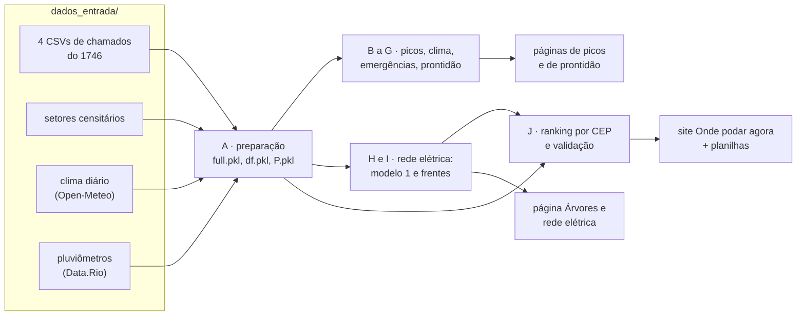

# O código do projeto, explicado

Aqui está **todo o código usado na análise de poda e rede elétrica** com os chamados do 1746: desde juntar as planilhas até os modelos de aprendizado de máquina e a montagem do site [Onde podar agora](https://heitor-oss.github.io/onde-podar-agora/).

Este guia foi escrito para os colegas do projeto. Não é preciso saber tudo de Python para acompanhar: cada parte explica o que faz e por quê.

**Atalhos:** [como rodar](#como-rodar-passo-a-passo) · [o caminho dos dados](#o-caminho-dos-dados) · [como ler uma etapa](#como-ler-uma-etapa) · [filtros e definições](#como-os-dados-foram-limpos-e-filtrados) · [modelos](#os-modelos-de-aprendizado-de-máquina) · [arquivos intermediários](#o-que-tem-em-cada-arquivo-intermediário) · [perguntas frequentes](#perguntas-frequentes) · [todas as etapas](ETAPAS.md)

---

## A ideia em uma frase

O código é uma **sequência de 71 etapas**, cada uma num arquivo Python. Elas rodam em ordem: cada etapa lê o que as anteriores gravaram, faz uma coisa e grava o resultado para as próximas. O nome do arquivo diz o grupo e a ordem: `H03_modelo1_treino_avaliacao.py` é a 3ª etapa do grupo H.

| Grupo | O que responde | Etapas mais importantes |
|---|---|---|
| **A** | Preparar os dados (juntar, limpar, enriquecer) | A01, A02, A03, A04 |
| **B** | Onde e quando há picos de chamados por CEP? Dá para prever? | B03, B04, B07 |
| **C** | O clima ajuda a prever? | C01, C02, C03 |
| **D** | Em quanto tempo um pedido não atendido vira emergência? | D01, D03, D05 |
| **E** | Num dia de temporal, onde caem as árvores? | E01, E02, E04 |
| **F** | Onde as equipes devem ficar de prontidão? | F02, F03 |
| **G** | A cobertura de árvores ajuda? Quem liga menos para o 1746? | G02, G03 |
| **H** | Árvores na fiação: dá para prever onde vai surgir o próximo pedido? | H01, H02, H03, H05 |
| **I** | Dá para ter menos desligamentos de energia agrupando a poda? | I03, I06 |
| **J** | Onde podar primeiro, e por quê? (o site) | J02, J03, J09, J12, J14, J18, J19 |

A lista completa, com o que cada etapa lê e grava, está em **[ETAPAS.md](ETAPAS.md)**.

---

## O caminho dos dados



Tudo o que é intermediário vai para a pasta `trabalho/`. O que é para usar (planilhas e o site) vai para `saidas/`.

---

## Como rodar, passo a passo

**1. Instale o Python** (versão 3.11 ou mais nova) em [python.org](https://www.python.org/downloads/). No Windows, marque a opção "Add Python to PATH" na instalação.

**2. Baixe o código.** No GitHub, botão verde **Code → Download ZIP**, e descompacte. (Quem usa git: `git clone https://github.com/heitor-oss/onde-podar-agora`.)

**3. Abra um terminal na pasta `codigo/`.** No Windows: abra a pasta no Explorador, clique na barra de endereço, digite `cmd` e Enter. No Mac: botão direito na pasta → "Novo Terminal na Pasta".

**4. Instale as bibliotecas** (só na primeira vez):
```
pip install -r requirements.txt
```

**5. Coloque os arquivos de entrada em `dados_entrada/`.** O clima e os pluviômetros já estão lá. Faltam dois, que são grandes demais para o GitHub e estão com o grupo do projeto:

| Arquivo | O que é |
|---|---|
| `chamados_completo_com_cep_parte1de4.csv` … `parte4de4.csv` | os chamados de manejo arbóreo do 1746 (set/2022 a set/2026), já com CEP, setor censitário e coordenada |
| `dados_finais_setor_v3_subtipos1a9.csv` | os setores censitários: bairro, região administrativa, população, área, cobertura de árvores e área construída |

**6. Rode:**
```
python rodar_tudo.py
```
Aparece uma linha por etapa com o tempo que levou. Tudo leva de 12 a 25 minutos. Se uma etapa der erro, o programa para e diz em qual arquivo de `logs/` está a mensagem.

**7. Veja os resultados:**
- `saidas/site/index.html` — o site, que abre em qualquer navegador;
- `saidas/ranking_ceps_poda.csv` — o ranking completo por CEP, para abrir no Excel ou no Google Planilhas;
- `saidas/ranking_areas_150m.csv` — o mesmo ranking agrupado em áreas de 150 m (CEPs vizinhos);
- `logs/` — o que cada etapa imprimiu: tabelas, métricas dos modelos, conferências.

Para rodar só uma parte, depois de ter rodado tudo uma vez:
```
python rodar_tudo.py J            # só o grupo J (ranking e site)
python rodar_tudo.py H02 H03      # só essas duas etapas
python rodar_tudo.py --a-partir H01
```

---

## Como ler uma etapa

Todo arquivo começa com um cabeçalho igual a este (da etapa H03):

```python
"""
Árvores e rede elétrica: trechos e modelo 1 · H03 — Modelo 1: treino e avaliação   ← grupo, código e nome
Tipo: principal                                     ← principal, exploratório, teste descartado ou biblioteca

O que faz:                                          ← em português simples
    Treina o gradient boosting (400 árvores, ...) e mede precisão no topo, AUC,
    calibração e importância por permutação, comparando com regras simples.

Lê:                                                 ← arquivos que precisam existir antes
    m_data.pkl
Grava:                                              ← arquivos que esta etapa cria
    gb.pkl, m_res.json
Usado em:                                           ← onde o resultado aparece
    Documento de aprendizado de máquina; página Light.
Script original da análise: light/m2.py
"""
import os, sys
sys.path.insert(0, os.path.dirname(os.path.abspath(__file__)))
from _comum import *     # define as pastas e passa a trabalhar em trabalho/
```

Depois do cabeçalho vem o código como foi rodado na análise. Uma sugestão para estudar: rode a etapa sozinha (`python rodar_tudo.py H03`), abra `logs/H03_modelo1_treino_avaliacao.txt` e compare o que foi impresso com o código.

---

## Como os dados foram limpos e filtrados

Estas regras aparecem espalhadas pelo código. Vale conhecê-las antes de mexer em qualquer coisa.

| Regra | Por quê | Onde |
|---|---|---|
| As 4 partes dos chamados são juntadas na ordem 1, 2, 4, 3 | É a ordem da análise original. Nenhuma contagem muda, mas alguns desempates dependem da ordem das linhas; assim os números batem exatamente | A01 |
| `d` = dia do chamado, sem a hora | Quase tudo é contado por dia | A01 |
| Pedidos ainda abertos têm a duração contada até 20/09/2026 | É o último dia dos dados | A02 |
| Bairro e região administrativa vêm do setor censitário do chamado | O 1746 traz só códigos | A02 |
| Zona da cidade pela região administrativa; RA desconhecida entra como Norte | Simplificação da análise; no ranking por CEP aparece como "zona não identificada" | A02 |
| **Pedido de poda** = subtipo que contém "Poda" | Inclui logradouro, vias públicas, "poda e remoção" | A02 e várias |
| **"Depende da Light"** = pedido de poda com status `Pendente` | A COMLURB não poda perto de fiação energizada e esses pedidos ficam parados. É uma aproximação: não temos os dados da Light | A02 (`pend`) |
| **Atendido** = `Fechado com solução` ou `Fechado com providências`; **aberto** = `Aberto` ou `Em Andamento` | Agrupa os status do 1746 | várias |
| **Aberto numa data passada** = criado antes da data e fechado depois dela (ou ainda aberto) | Usar o status de hoje para o passado "vazaria" informação do futuro | J07, J11 |
| **Emergência** = `Retirada de árvore caída` ou `Avaliação de risco de queda da árvore` | São os chamados de risco imediato | B, D |
| Coordenadas fora do retângulo do município são descartadas (latitude −23,10 a −22,73; longitude −43,80 a −43,09) | Erros de localização | E, F, J16 |
| **Quadrado de ~1 km:** `gx = int((lon + 43,8) × 102,5)`, `gy = int((lat + 23,1) × 110,6)` | Grade simples para mapas e prontidão | E, F, J16 |
| **Trecho de rua** = logradouro + faixa de 100 números de porta (0–99, 100–199…); só números entre 1 e 99.999 | Unidade do modelo 1; números fora disso são erro de digitação | H, I, J |
| **Pico emergencial** = 3+ chamados de emergência em 2+ endereços no mesmo CEP e dia | Exigir 2 endereços evita contar várias pessoas ligando pela mesma árvore | B04 |
| **Dia de temporal** = 40+ árvores caídas na cidade (E e G usam 20+) | Marca os dias de evento climático | B03, E01, G01 |
| **Fechamento em massa** = poda fechada como `Fechado com providências` em 13 ou 14/10/2025 depois de 180+ dias | Cerca de 3.900 pedidos fechados de uma vez; testados e deixados fora da nota | J06 |

---

## Os modelos de aprendizado de máquina

A explicação didática, com exemplos e resultados, está no documento **[Aprendizado de máquina no projeto de poda](../docs/aprendizado_de_maquina.md)**. Aqui fica onde cada modelo está no código:

| Modelo | Pergunta | Técnica | Onde |
|---|---|---|---|
| **Modelo 1** | Quais trechos de rua terão novo pedido que depende da Light em 12 meses? | Gradient boosting (`HistGradientBoostingClassifier`: 400 árvores, taxa 0,04, até 31 folhas, 40 trechos por folha, L2 = 1) | variáveis em [H02](etapas/H02_modelo1_dados.py), treino em [H03](etapas/H03_modelo1_treino_avaliacao.py) |
| **Modelo 2** | Quais CEPs terão pico de emergência amanhã? | Regressão logística (log(1+x), padronização, C = 0,3, pesos balanceados) | [B07](etapas/B07_modelo2_picos_logistica.py), com clima em [C03](etapas/C03_modelo2_com_clima.py) |
| **Modelo 3** | Onde ficar de prontidão amanhã? | Regressão de Poisson por quadrado-dia, com interações histórico × clima | [F02](etapas/F02_modelo3_prontidao_poisson.py) |
| **Nota de prioridade** | Onde podar primeiro? | Soma ponderada de 5 sinais; pesos escolhidos por busca e testados em 8 períodos | nota em [J03](etapas/J03_nota_por_cep.py), pesos em [J09](etapas/J09_otimizar_pesos.py) e [J12](etapas/J12_robustez_dos_pesos.py) |

Também ficaram no código os modelos testados e descartados, para registro: gradient boosting para picos ([B06](etapas/B06_modelo2_picos_gbm.py)) e no lugar da nota ([J10](etapas/J10_comparar_com_gbm.py)).

---

## O que tem em cada arquivo intermediário

Os arquivos de `trabalho/` são tabelas do pandas (`.pkl`), matrizes do numpy (`.npz`) ou resultados (`.json`). Para olhar um deles em Python:

```python
import pandas as pd
df = pd.read_pickle('trabalho/df.pkl')
df.head()
```

| Arquivo | O que tem | Criado em |
|---|---|---|
| `full.pkl` | os 169.816 chamados, como vieram dos CSVs, + coluna `d` | A01 |
| `df.pkl` | os mesmos chamados com datas convertidas, duração, bairro e RA | A02 |
| `P.pkl` | só os 117.680 pedidos de poda, com `pend` (depende da Light) e `zona` | A02 |
| `clima.pkl` | clima diário da cidade | A03 |
| `estacoes_diario.pkl` | chuva diária por pluviômetro, com coordenadas | A04 |
| `mats.npz` | matrizes CEP × dia: todos os chamados, quedas, avaliações de risco | B03 |
| `cepday.pkl` | uma linha por CEP e dia com chamados (quantos, onde, quando) | B03 |
| `ev.pkl`, `vol.pkl` | os picos emergenciais e os picos de volume | B04 |
| `Ptr.pkl` | pedidos de poda com o trecho de rua | H01 |
| `m_data.pkl` | variáveis e alvos do modelo 1 nas 4 datas | H02 |
| `gb.pkl` | o modelo 1 treinado | H03 |
| `cepg.pkl`, `cep_rank.pkl` | sinais e nota por CEP hoje | J02, J03 |
| `pri_feats.pkl`, `pri_roll.pkl` | sinais por CEP em datas passadas e o que aconteceu depois (para validar) | J07, J11 |
| `rank_data.json`, `cell_quedas.json` | os dados que entram no site (o `rank_data.json` ganha a área de 150 m de cada CEP em J18) | J04, J16, J18 |
| `area_bt.json` | teste de 2025: olhar por área de 150 m ou por CEP | J18 |

---

## Perguntas frequentes

**Preciso rodar tudo toda vez?** Não. Depois da primeira vez, os intermediários ficam em `trabalho/`, e dá para rodar só o grupo ou a etapa que interessa.

**Deu `ModuleNotFoundError`.** Falta instalar as bibliotecas: `pip install -r requirements.txt`.

**Deu "Faltam as partes … dos chamados".** Os 4 CSVs não estão em `dados_entrada/`, ou estão com outro nome. Os nomes precisam terminar em `parte1de4.csv` … `parte4de4.csv`.

**Como atualizo com dados mais novos?** Troque os CSVs em `dados_entrada/` e procure, dentro de `etapas/`, as datas `2026-09-20` (fim dos dados) e `2026-09-21` (o "hoje" do ranking) para trocá-las pela nova data. O clima precisa ser baixado de novo da [API histórica do Open-Meteo](https://open-meteo.com/en/docs/historical-weather-api), mantendo as mesmas colunas, e os pluviômetros com o notebook em `notebooks/`. Depois, refaça o teste dos pesos (J11 a J13): os melhores pesos mudam com o tempo.

**Por que tem nomes de variáveis em inglês e abreviados?** São os scripts como foram rodados na análise, mexidos o mínimo, para os números baterem exatamente com o que foi publicado. Os cabeçalhos explicam cada um em português.

**O que é aquele `exec(open(etapa(...)).read().split(...)[0])`?** Algumas etapas reaproveitam o começo de outra. Por exemplo, J01 roda a parte de H02 que monta as variáveis do modelo 1. Por isso, não apague os trechos usados como marcadores (`def label`, `origins=`, `res={}`, `rows=[]`, `R={}`) sem ajustar quem os usa.

**De onde veio o clima?** Da API histórica do Open-Meteo, consultada para vários pontos da cidade e resumida por dia (média e máximo entre os pontos). A lista exata de pontos não ficou registrada.

**E as outras páginas do projeto?** As páginas "Picos de chamados por CEP", "Árvores e rede elétrica" e o "Painel do piloto" usam os resultados destas etapas, mas o código que as montou não foi guardado em arquivo. Só o site "Onde podar agora" é montado aqui (J19); a página de picos está no site já pronta (`picos-de-chamados.html`).

---

## Conferência

O pacote foi rodado do zero em 13/10/2026, a partir dos CSVs originais, numa pasta nova:

- **31 dos 33 resultados (`.json`) são idênticos** aos da análise. Os outros dois diferem só por campos acrescentados à mão depois, na análise original (`data.json` ganhou o clima de cada temporal; `pri_page.json`, uma tabela que não é mais usada).
- **O ranking, a lista de trechos, o mapa de quedas e o site são idênticos** aos publicados.
- Todas as sementes aleatórias estão fixas no código, então rodar de novo dá o mesmo resultado.
