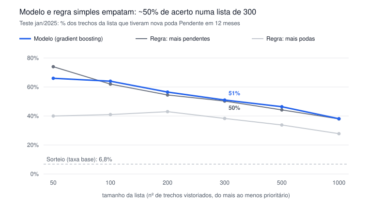

# Aprendizado de máquina no projeto de poda

Heitor · projeto de extensão *Ciência de Dados para Cidades Inteligentes* (UFRJ) · outubro de 2026

> **Onde está o código de cada modelo** (pasta [`codigo/`](../codigo/)):
> Modelo 1 → [`H02`](../codigo/etapas/H02_modelo1_dados.py) (variáveis) e [`H03`](../codigo/etapas/H03_modelo1_treino_avaliacao.py) (treino e avaliação) ·
> Modelo 2 → [`B07`](../codigo/etapas/B07_modelo2_picos_logistica.py) e [`C03`](../codigo/etapas/C03_modelo2_com_clima.py) (com clima) ·
> Modelo 3 → [`F02`](../codigo/etapas/F02_modelo3_prontidao_poisson.py) ·
> frentes de desligamento → [`I03`](../codigo/etapas/I03_frentes_algoritmo_guloso.py) e [`I06`](../codigo/etapas/I06_frentes_estoque_atual_e_vizinhos.py).

## 1. Para que usamos aprendizado de máquina aqui

Este documento explica, passo a passo, todos os modelos de aprendizado de máquina (*machine learning*) usados na análise de poda de árvores no Rio de Janeiro. A ideia é que alguém sem formação em estatística consiga entender **o que cada modelo faz, com quais dados, como foi testado e o quanto podemos confiar nele**.

A única fonte de dados de pedidos é o **1746**: 169.816 chamados, dos quais 117.680 são de poda ou parecidos (risco de queda, árvore caída, remoção). Não temos o histórico de desligamentos da Light nem o inventário de árvores da cidade. Tudo o que o modelo "sabe" vem de quem ligou, onde, quando e com que resultado.

Usamos três modelos, cada um para responder a uma pergunta diferente:

| # | Pergunta | Unidade de análise | Tipo de modelo |
| --- | --- | --- | --- |
| 1 | Em quais trechos de rua vai aparecer um pedido de poda que depende da Light nos próximos 12 meses? | Trecho de rua (100 números de porta) | Gradient boosting (árvores de decisão em sequência) |
| 2 | Em quais CEPs vai acontecer um pico de emergência (várias quedas no mesmo dia)? | CEP em um dia | Regressão logística |
| 3 | Em quais áreas de 1 km as equipes devem ficar de prontidão amanhã? | Quadrado de 1 km em um dia | Regressão de Poisson |

O **Modelo 1** é o principal, porque é o que mais se aproxima da pergunta "árvores tocando a rede elétrica". Os modelos 2 e 3 tratam de emergências (quedas) e usam também o clima.

Um aviso desde já: em vários casos, **uma regra simples** ("olhe primeiro onde já houve muitos pedidos pendentes") acerta quase tanto quanto o modelo. Isso não é um defeito do documento; é um dos resultados. Mostraremos onde o modelo de fato acrescenta algo.

## 2. Conceitos básicos antes dos modelos

### 2.1 O que é um modelo preditivo

Um modelo preditivo é uma função que recebe uma lista de números sobre um lugar (as **variáveis explicativas**, ou *features*) e devolve um palpite sobre algo que ainda não aconteceu (o **alvo**, ou *target*).

Exemplo concreto do Modelo 1:

- **Lugar:** o trecho da Rua X entre os números 200 e 299.
- **Variáveis:** quantos pedidos de poda esse trecho já teve, quantos ficaram pendentes, há quantos dias foi o último pedido pendente, quantos pendentes há nos trechos vizinhos, etc.
- **Alvo:** "nos próximos 12 meses, esse trecho vai ter pelo menos 1 pedido novo que fica Pendente?" (sim = 1, não = 0).
- **Saída do modelo:** uma probabilidade, por exemplo 0,42 (42%).

O modelo "aprende" olhando milhares de exemplos do passado em que já sabemos a resposta, e procura padrões do tipo "trechos com pendência recente e vizinhos com pendência costumam ter pendência de novo".

### 2.2 Por que "Pendente" representa a Light

O 1746 não diz explicitamente "esta árvore está na rede elétrica". Mas, quando a poda envolve fiação energizada, a COMLURB não pode executar e o chamado fica parado com status **Pendente**. Na análise, 13,1% dos pedidos da COMLURB estão nesse estado, nunca foram fechados e têm idade média de 780 dias. Por isso usamos "ficou Pendente" como **aproximação** (proxy) de "depende da Light". É uma aproximação, não um dado oficial: esse ponto volta na seção de limitações.

### 2.3 Treino e teste separados no tempo

Um modelo só é útil se acerta casos que **não viu** durante o aprendizado. Por isso dividimos os dados em duas partes:

- **Treino:** fotografias da cidade tiradas em 01/07/2023 e 01/01/2024. Para cada fotografia, calculamos as variáveis com tudo o que aconteceu **até** aquela data e o alvo com o que aconteceu nos **12 meses seguintes**.
- **Teste:** fotografias em 01/01/2025 e 01/07/2025, feitas do mesmo jeito. O modelo nunca viu esses períodos.

Pense numa prova: o aluno estuda com as provas de 2023 e 2024 e é avaliado com a prova de 2025. Se a gente embaralhasse os anos, o modelo poderia "decorar" o futuro e parecer melhor do que é.

### 2.4 Vazamento de informação (leakage)

Vazamento é quando, sem querer, alguma informação do futuro entra nas variáveis. Aqui havia um risco real: o status "Pendente" que temos é o status **de hoje**, não o status na data da fotografia. Um pedido de 2024 que hoje aparece como Pendente pode, em 2024, ainda estar só "aberto".

Para medir esse efeito, refizemos tudo contando como pendente na data da fotografia apenas pedidos que já tinham pelo menos 60 ou 180 dias de idade naquela data (ou seja, que já "pareciam" travados). A precisão caiu só de 1 a 3 pontos percentuais. Conclusão: o vazamento existe, mas é pequeno e não muda as conclusões.

## 3. Modelo 1: onde vai surgir poda que depende da Light

### 3.1 A unidade: o trecho de rua

Cada endereço do 1746 tem um código de logradouro e um número de porta. Agrupamos os números de 100 em 100: os números 0–99 da Rua X são um trecho, 100–199 outro, e assim por diante. Em fórmula: trecho = código do logradouro + parte inteira de (número ÷ 100). Um trecho tem, na prática, uma ou duas quadras.

Não avaliamos todos os trechos da cidade, só os **candidatos**: trechos que já tiveram pelo menos um pedido de poda, risco, queda ou remoção, ou que ficam numa rua com pedido de poda. São cerca de 30 mil trechos por fotografia.

### 3.2 As 22 variáveis

Para cada trecho e cada data de fotografia, calculamos:

| Grupo | Variáveis | O que mede |
| --- | --- | --- |
| Histórico de poda | poda\_all, poda\_365, poda\_180 | pedidos de poda em todo o passado, no último ano, nos últimos 6 meses |
| Histórico de pendência | pend\_all, pend\_365, pend\_180 | quantos desses ficaram Pendentes (proxy da Light) |
| Atendimento | served\_all | pedidos de poda atendidos |
| Outros tipos | risk, queda, remo | risco de queda, árvore caída, remoção |
| Contexto do chamado | vias, ouv, rec | pedidos de poda em via, pela ouvidoria, reclamações |
| Tempo | dias\_ult\_atend, dias\_ult\_pedido, dias\_ult\_pend | dias desde o último atendimento, pedido e pendência (9999 se nunca houve) |
| Vizinhança | viz\_pend, viz\_poda | pendentes e podas nos trechos imediatamente ao lado (±1) |
| Rua | rua\_pend, rua\_poda | pendentes e podas no resto da mesma rua |
| Setor censitário | arv, constr | cobertura de árvores e de construção no setor |

Repare que todas são contagens ou tempos simples. Não há nada "mágico": o modelo só combina esses números de um jeito mais flexível que uma regra feita à mão.

### 3.3 O que é uma árvore de decisão

Uma árvore de decisão é uma sequência de perguntas de sim ou não. Por exemplo:

```
A última pendência foi há menos de 400 dias?
├─ sim → Há mais de 2 pendentes no resto da rua?
│         ├─ sim → chance de 45%
│         └─ não → chance de 22%
└─ não → O trecho vizinho tem pendente?
          ├─ sim → chance de 12%
          └─ não → chance de 3%
```

Cada "folha" (o fim de um caminho) guarda a proporção de trechos do treino que, naquelas condições, tiveram pendência nova. Os cortes (400 dias, 2 pendentes) não são escolhidos por nós: o algoritmo testa muitos cortes possíveis e fica com o que melhor separa os "sim" dos "não". (Os números acima são ilustrativos.)

Uma única árvore é fácil de ler mas grosseira: ou ela é pequena e erra muito, ou é grande e decora o treino.

### 3.4 Gradient boosting: muitas árvores corrigindo umas às outras

O *gradient boosting* resolve isso construindo centenas de árvores pequenas, **uma depois da outra**, cada uma tentando corrigir o erro acumulado das anteriores:

1. Começa com um palpite igual para todos os trechos: a taxa média (6,8% dos candidatos têm pendência nova em 12 meses).
2. Calcula o erro de cada trecho: quem teve pendência e recebeu 6,8% está "abaixo"; quem não teve está "acima".
3. Treina uma árvore pequena para prever **esse erro** a partir das 22 variáveis.
4. Soma ao palpite uma fração pequena da árvore nova (a *taxa de aprendizado*, 0,04 = 4%).
5. Volta ao passo 2. Repete 400 vezes.

Uma analogia: é como acertar uma tacada de golfe em várias tacadas curtas. A primeira deixa a bola longe; cada tacada seguinte mira na distância que ainda falta. Passos pequenos (4%) evitam passar do buraco.

No fim, a previsão de um trecho é a soma das contribuições das 400 árvores, convertida em probabilidade entre 0 e 1.

### 3.5 Os ajustes usados (hiperparâmetros)

Usamos a implementação `HistGradientBoostingClassifier` da biblioteca scikit-learn, com:

| Ajuste | Valor | Significado |
| --- | --- | --- |
| max\_iter | 400 | número de árvores |
| learning\_rate | 0,04 | quanto cada árvore nova pesa |
| max\_leaf\_nodes | 31 | cada árvore tem no máximo 31 folhas (árvores pequenas) |
| min\_samples\_leaf | 40 | cada folha precisa ter pelo menos 40 trechos, para não aprender casos isolados |
| l2\_regularization | 1,0 | penaliza folhas com valores extremos, deixando o modelo mais conservador |

Esses valores foram escolhidos de forma conservadora, sem busca exaustiva. Todos os três últimos servem ao mesmo objetivo: **evitar que o modelo decore o treino** (o chamado *overfitting*).

### 3.6 Como os dados de treino foram montados

```
fotografia 01/07/2023 → variáveis com o passado → alvo: jul/2023 a jun/2024  ┐
fotografia 01/01/2024 → variáveis com o passado → alvo: jan/2024 a dez/2024  ┘ TREINO (empilhadas)

fotografia 01/01/2025 → variáveis com o passado → alvo: jan/2025 a dez/2025  ┐
fotografia 01/07/2025 → variáveis com o passado → alvo: jul/2025 a jun/2026  ┘ TESTE
```

As duas fotografias de treino são colocadas uma embaixo da outra (empilhadas), o que dobra o número de exemplos. O mesmo trecho aparece duas vezes, com variáveis e alvos diferentes, porque a situação dele mudou entre as duas datas.

## 4. Como medimos se o modelo é bom

Não existe uma única nota. Usamos cinco formas de olhar, cada uma respondendo a uma pergunta prática.

### 4.1 Precisão no topo da lista (precision@k)

**Pergunta prática:** se a equipe só consegue vistoriar k trechos, quantos deles realmente vão ter problema?

Como calcula: ordena todos os trechos do teste da maior para a menor probabilidade, pega os k primeiros e conta quantos tiveram pendência nova em 12 meses.

Exemplo: lista de 100 trechos, 64 tiveram pendência nova → precision@100 = 64/100 = 0,64.

Esta é a métrica mais importante para o uso real, porque a capacidade das equipes é limitada: ninguém vai vistoriar 30 mil trechos.

### 4.2 AUC: o modelo ordena bem?

**Pergunta prática:** se eu pegar um trecho que teve problema e um que não teve, ao acaso, com que frequência o modelo dá nota maior ao que teve?

- AUC = 0,5: o modelo não é melhor que sortear.
- AUC = 1,0: o modelo sempre acerta a ordem.
- Na prática, 0,7 a 0,8 é considerado razoável; acima de 0,8, bom.

A AUC olha a lista inteira, inclusive o fundo, que interessa pouco na operação. Por isso ela complementa, mas não substitui, a precision@k.

### 4.3 Calibração: a probabilidade é "honesta"?

**Pergunta prática:** quando o modelo diz 40%, acontece em 40% das vezes?

Como calcula: divide os trechos em 10 grupos (decis) pela probabilidade prevista e compara, em cada grupo, a média prevista com a proporção que de fato aconteceu. Um modelo bem calibrado tem as duas quase iguais.

Isso importa se alguém for usar o número como risco ("este trecho tem 40% de chance"), e não só como ordem.

### 4.4 Comparação com regras simples e com sorteio

Um modelo só se justifica se for melhor que alternativas baratas. Comparamos sempre com:

- **Sorteio:** lista aleatória de candidatos. A precisão esperada é a taxa base (6,8%).
- **Regra "mais pendentes":** ordena os trechos por quantos pedidos pendentes já tiveram. Não tem aprendizado nenhum.
- **Regra "mais podas":** ordena por quantos pedidos de poda já tiveram (qualquer status).

Se o modelo empata com a regra "mais pendentes", a mensagem honesta é: **a regra basta**, e o modelo só vale onde ganhar dela.

### 4.5 Importância das variáveis por permutação

**Pergunta prática:** quais variáveis o modelo realmente usa?

Como calcula, para cada variável:

1. Mede a qualidade do modelo no teste (usamos a *average precision*, uma média da precisão ao longo da lista).
2. Embaralha os valores daquela variável entre os trechos, quebrando a ligação dela com o alvo, e mede de novo.
3. A queda na qualidade é a importância da variável.

Se embaralhar uma variável não muda nada, o modelo não depende dela. Exemplo: embaralhar "dias desde a última pendência" é como trocar o histórico de cada trecho pelo de outro trecho qualquer; se a qualidade cai muito, essa informação era essencial.

## 5. Resultados do Modelo 1

### 5.1 Ordenação geral

A AUC foi **0,765** no teste de janeiro de 2025 e **0,763** no de julho de 2025. Ou seja: o modelo ordena os trechos de forma razoável e o desempenho praticamente não muda entre os dois períodos de teste, o que é um bom sinal de estabilidade. A taxa base é 6,8%: de cada 100 trechos candidatos, cerca de 7 têm pendência nova em 12 meses.

### 5.2 Precisão no topo da lista



*Chamados 1746 · avaliação do Modelo 1 na fotografia de 01/01/2025 (≈30 mil trechos candidatos)*

Três leituras do gráfico:

- No topo absoluto (lista de 50) a regra "mais pendentes" chega a acertar mais que o modelo. De 100 trechos em diante, os dois andam praticamente juntos.
- A regra "mais podas" fica bem atrás. O que antecipa um problema com a rede elétrica é **pendência passada**, não volume de pedidos.
- Qualquer um dos dois métodos acerta de 5 a 10 vezes mais que um sorteio.

Conclusão honesta: **para a lista geral, a regra simples basta.** Ela é transparente, fácil de explicar e não precisa de treinamento.

### 5.3 Onde o modelo ganha: trechos que nunca tiveram pendência

A regra "mais pendentes" tem um ponto cego óbvio: trechos com zero pendências empatam todos em zero, e ela não tem como ordená-los. O modelo consegue, porque olha vizinhos, a rua, o tempo desde o último pedido e o setor censitário.

Restringindo a avaliação a trechos **sem nenhuma pendência anterior**:

| Tamanho da lista | Precisão do modelo |
| --- | --- |
| 50 | 28% |
| 100 | 20% |
| 200 | 17% |
| 300 | 15,3% |
| 500 | 15% |
| 1000 | 13,6% |

Nesse grupo, a regra fica entre 4% e 7,4% em todos os tamanhos, praticamente um sorteio (cerca de 4%). O modelo acerta de 3 a 5 vezes mais. **É aqui que o aprendizado de máquina se paga:** apontar onde o problema vai aparecer pela primeira vez.

### 5.4 Calibração

No decil mais alto (os 10% de trechos com maior nota), o modelo previu em média **37,1%** de chance, mas aconteceu em **26,1%**. Ele superestima o risco no topo.

Na prática: a nota do modelo deve ser usada para **ordenar** prioridades, não lida como "chance exata". Se alguém quiser usar o número como probabilidade, é preciso recalibrá-lo com dados mais recentes.

### 5.5 Quais variáveis o modelo usa

Importância por permutação (queda da *average precision* quando a variável é embaralhada):

| Variável | Importância | Leitura |
| --- | --- | --- |
| dias\_ult\_pend | 0,073 | há quanto tempo foi a última pendência no trecho |
| rua\_pend | 0,035 | pendências no resto da rua |
| viz\_pend | 0,015 | pendências nos trechos vizinhos |
| constr | 0,0145 | área construída no setor censitário |
| arv | 0,013 | cobertura de árvores no setor censitário |
| demais 17 | ≈ 0 | informação repetida pelas de cima |

Quase tudo vem de uma única ideia: **"houve pendência recente aqui ou perto daqui?"**. As variáveis de árvores e construção ajudam pouco, mas são justamente as que permitem ao modelo dar nota a trechos sem histórico. As outras 17 não são inúteis em si; elas apenas repetem informação que as cinco primeiras já trazem (por exemplo, pend\_365 e dias\_ult\_pend dizem quase a mesma coisa).

### 5.6 Mudando a escala: a rua inteira e um prazo maior

Prever "em qual quadra" é difícil. Prever "em qual rua" é bem mais fácil. Usando a regra "mais pendentes" com lista de 300, a partir de 2025:

| Unidade | Prazo | Precisão | Sorteio |
| --- | --- | --- | --- |
| Trecho de 100 números | 12 meses | 48% a 50% | 7,8% |
| Trecho de 500 números | 18 meses | 83% a 84,7% | 17,9% |
| Rua inteira | 12 meses | 82,7% a 84,3% | 14,9% |
| Rua inteira | 18 meses | 90,3% a 93% | 19,9% |

(As faixas vêm das duas formas de tratar o vazamento da seção 2.4.)

Para planejar **rotas de poda por rua**, a regra simples já acerta 8 ou 9 de cada 10 ruas indicadas.

### 5.7 Da lista às frentes de trabalho

Uma lista de trechos ainda não é um plano. Como cada desligamento da rede custa caro, faz sentido juntar pedidos próximos numa mesma **frente** (uma janela de desligamento). Para isso usamos um algoritmo **guloso** de agrupamento:

1. Pega o pedido pendente que tem mais pedidos pendentes num raio R (por exemplo 150 m).
2. Cria uma frente com ele e todos esses vizinhos e os tira da lista.
3. Repete até não sobrar pedido.

"Guloso" quer dizer que, a cada passo, ele escolhe o melhor agora, sem planejar o conjunto inteiro. Não garante a solução ótima, mas é simples e rápido. Com o estoque atual de 13.083 pedidos pendentes em 6.933 trechos:

| Raio | Frentes | Pedidos por frente | Frentes para cobrir metade do estoque |
| --- | --- | --- | --- |
| 150 m | 3.187 | 4,1 | 483 |
| 300 m | 1.563 | 8,4 | 173 |

O problema também se espalha pela vizinhança. Dos pedidos novos dependentes da Light que surgiram em 2025 em trechos sem estoque, **67% ficavam a até 150 m de um trecho com estoque** (para os demais pedidos de poda, usados como controle, a proporção é 47%). Por isso, estender cada frente aos trechos vizinhos (até 150 m) aumenta muito a cobertura dos pedidos de 2025: as 500 primeiras frentes cobrem 32% se olharmos só os trechos do estoque e 50% incluindo os vizinhos; as 1.000 primeiras, 44% e 67%.

Vale notar: este agrupamento é geometria, não aprendizado de máquina. O papel do Modelo 1 aqui é complementar: **entre os muitos vizinhos de uma frente, indicar quais merecem vistoria** durante o mesmo desligamento, sobretudo os que nunca tiveram pendência (seção 5.3).

## 6. Modelo 2: picos de emergência por CEP

### 6.1 A pergunta e o alvo

Aqui a pergunta muda de "poda preventiva" para "emergência": **em quais CEPs vai haver um pico amanhã?** Chamamos de pico emergencial um CEP-dia com **3 ou mais chamados de queda ou risco de queda, em pelo menos 2 endereços diferentes**. A exigência de 2 endereços evita contar como pico várias pessoas ligando pela mesma árvore.

A unidade é o **CEP em um dia**. Picos são raríssimos: há milhões de CEP-dias e só algumas dezenas de picos no período de treino.

### 6.2 As variáveis, em camadas

Testamos o modelo acrescentando informação aos poucos, para ver o que cada camada acrescenta:

| Camada | Variáveis |
| --- | --- |
| Próprio CEP | chamados totais e de emergência no CEP em 1, 7, 30, 90 e 365 dias; picos anteriores no CEP |
| + Cidade até a véspera | total de chamados e de quedas na cidade ontem; quedas nos últimos 3 dias |
| + Clima do dia | chuva média, chuva máxima em uma hora, rajada de vento (Open-Meteo), como se a previsão do tempo fosse perfeita |
| Referência (oráculo) | número de quedas na cidade **no próprio dia**, informação que só se tem depois; serve de teto |

### 6.3 Regressão logística, passo a passo

A regressão logística é um dos modelos mais simples para prever "sim ou não". Ela faz duas contas:

1. **Soma ponderada:** pontuação = b0 + b1·x1 + b2·x2 + …, em que x1, x2… são as variáveis e b1, b2… são pesos aprendidos. Um peso positivo grande quer dizer "esta variável aumenta muito o risco".
2. **Curva em S:** probabilidade = 1 ÷ (1 + e^(−pontuação)). Essa curva transforma qualquer número em algo entre 0 e 1: pontuação 0 vira 50%; pontuação −3 vira cerca de 5%; pontuação +3 vira cerca de 95%.

Uma imagem geométrica: com duas variáveis, cada CEP-dia é um ponto num plano. A regressão logística traça uma **reta** separando a região de "pico" da de "não pico"; a curva em S diz o quão longe da reta o ponto está e, portanto, o quão confiante é o palpite. Com mais variáveis, a reta vira um plano (ou "hiperplano"), mas a ideia é a mesma.

Antes de ajustar o modelo, três cuidados:

- **log(1 + x) nas contagens:** a diferença entre 0 e 5 chamados importa mais que entre 100 e 105. O logaritmo comprime os valores grandes.
- **Padronização:** cada variável é transformada para ter média 0 e desvio 1, para que pesos de variáveis com escalas diferentes sejam comparáveis.
- **Regularização (C = 0,3):** penaliza pesos muito grandes, o que deixa o modelo mais prudente quando há poucos exemplos.

### 6.4 Lidando com a raridade

Com milhões de CEP-dias e poucas dezenas de picos, um modelo que sempre diz "não" acertaria 99,99% das vezes e seria inútil. Duas técnicas:

- **Amostragem de negativos:** usamos todos os picos, mas só 1,5 milhão de CEP-dias sem pico sorteados, em vez de todos.
- **Pesos balanceados** (class\_weight = balanced): cada pico errado custa, no aprendizado, tanto quanto milhares de "não picos" errados.

Treino: dias antes de 2025. Teste: 2025 e 2026.

### 6.5 Por que não gradient boosting aqui?

Testamos. Com apenas **57 picos no treino**, o boosting decorou os poucos exemplos e foi pior no teste. A regressão logística, por ser mais rígida (só consegue traçar "retas"), é mais segura com poucos dados. Esta é uma regra geral: **quanto menos exemplos, mais simples deve ser o modelo.**

### 6.6 Resultados

Métrica principal: **recall nos 5% de maior risco**, ou seja, de todos os picos reais do teste, quantos caíram entre os 5% de CEP-dias com maior nota.

| Informação usada | AUC | Picos capturados nos 5% de maior risco |
| --- | --- | --- |
| Só o próprio CEP | 0,81 | 40% |
| + cidade até a véspera | 0,83 | 42% |
| + clima do dia (previsão perfeita) | 0,86 | 47% |
| Referência: quedas na cidade no próprio dia | 0,95 | 76% |

Leitura:

- O histórico do CEP sozinho já captura 4 em cada 10 picos. **Onde já houve problema, volta a haver.**
- O clima ajuda, mas pouco (+5 pontos). Usar só o clima observado na véspera, em vez da previsão do dia, praticamente não ajuda (41%).
- A referência mostra o teto: se soubéssemos de manhã o tamanho do temporal daquele dia, capturaríamos 76%. A distância entre 47% e 76% é o que uma boa previsão do tempo **localizada** poderia recuperar.
- Com poucos picos no teste, esses percentuais têm margem de erro grande (alguns pontos para cima ou para baixo).

## 7. Modelo 3: onde as equipes devem ficar de prontidão

### 7.1 A pergunta e a unidade

**Amanhã, em quais áreas da cidade as equipes de emergência devem estar mais perto?** Dividimos o Rio em quadrados de cerca de 1 km × 1 km e, para cada quadrado e cada dia, contamos quantos chamados de "retirada de árvore caída" aconteceram. A unidade é o **quadrado-dia**.

Diferente dos modelos anteriores, aqui o alvo não é "sim ou não", é uma **contagem** (0, 1, 2, 3… quedas).

### 7.2 Regressão de Poisson

A regressão de Poisson é a prima da logística para contagens:

1. Mesma soma ponderada: pontuação = b0 + b1·x1 + b2·x2 + …
2. Em vez da curva em S, usa a exponencial: quedas esperadas = e^(pontuação). Assim o resultado é sempre positivo. Pontuação −3 dá cerca de 0,05 queda esperada; pontuação 0 dá 1 queda; pontuação +1 dá cerca de 2,7.

Como a exponencial transforma somas em multiplicações, cada variável age como um **multiplicador** do risco. Por exemplo, "chuva forte multiplica por 3 as quedas esperadas" é uma frase que o modelo de Poisson consegue expressar naturalmente.

### 7.3 Interações: chuva pesa mais onde já há histórico

Uma chuva forte não derruba árvores onde não há árvores. Para captar isso, incluímos variáveis de **interação**: o histórico do quadrado multiplicado por cada variável de clima. Geometricamente, sem interação a chuva desloca o risco de todos os quadrados igualmente; com interação, a chuva "inclina" o mapa, elevando muito mais os quadrados que já tinham muitas quedas.

### 7.4 As variáveis

| Camada | Variáveis |
| --- | --- |
| Mapa fixo | total de chamados no quadrado em todo o passado |
| + Pedidos recentes | quedas no histórico e no último ano; pedidos preventivos em 7 e 30 dias; pedidos de risco em 14 dias; pedidos preventivos ainda em aberto |
| + Cidade na véspera | quedas em toda a cidade ontem |
| + Clima do dia | chuva média, chuva máxima em 1 hora, rajada (hoje e ontem), chuva acumulada nos 7 dias anteriores, com interações |

Treino até o fim de 2024; teste de 2025 a setembro de 2026.

### 7.5 Como avaliamos: orçamento de alerta

A equipe não pode ficar de prontidão em toda a cidade todos os dias. Então fixamos um **orçamento**: só 5% dos quadrados-dia do período de teste podem ser marcados como "alerta". A pergunta é: escolhendo os 5% com mais quedas esperadas, **que parcela de todas as quedas reais caíu dentro de um quadrado em alerta?**

| Informação usada | Quedas capturadas com 5% de orçamento |
| --- | --- |
| Mapa fixo (só histórico) | 20% |
| + pedidos recentes | 24% |
| + cidade na véspera | 35% |
| + clima do dia (Poisson) | 39% |
| + clima do dia (gradient boosting) | 38% |
| Referência: quedas da cidade no próprio dia | 54% |

Leitura:

- O maior salto vem de saber **como a cidade estava ontem** (de 24% para 35%). Temporais costumam durar mais de um dia, então muitas quedas ontem antecipam muitas quedas hoje.
- O clima acrescenta mais 4 pontos.
- O gradient boosting **não** supera a regressão de Poisson aqui. Quando um modelo simples empata com um complexo, ficamos com o simples.

### 7.6 A versão "regra de bolso"

O modelo inspirou uma regra simples para uso diário: **em dias normais, alertar os 10 quadrados de maior histórico; em dias de alerta de chuva ou vento, alertar 200.** Essa regra usa cerca de 5,7% do orçamento e captura cerca de 38% das quedas, praticamente o mesmo que o modelo completo.

### 7.7 E no dia do temporal, dá para saber onde?

Analisando só os dias de temporal (análise complementar, sem modelo novo):

- Os 10% de quadrados com maior histórico concentram cerca de **35%** das quedas do dia.
- Usar a chuva local de cada estação para ordenar os quadrados captura só 21%: a chuva varia muito de rua para rua e as estações são esparsas.
- Atualizando a lista ao longo do dia com as primeiras quedas registradas (os primeiros 30% das quedas daquele dia), a captura sobe para **42%**, ou **45%** combinando com o histórico.

## 8. Limitações e o que melhoraria os modelos

### 8.1 O que os modelos não sabem

- **"Pendente" é uma aproximação da Light, não um dado da Light.** Não temos o histórico de desligamentos, a localização da rede nem as ordens de serviço de poda da concessionária. O Modelo 1 prevê "pedido que trava por depender da Light", o que é parecido, mas não igual, a "árvore tocando a rede".
- **O modelo prevê onde as pessoas ligam, não onde as árvores estão.** Bairros que ligam menos ficam com nota baixa mesmo tendo problema. Há indício disso: nos setores que menos pedem poda, há 10,8 quedas para cada 100 pedidos; nos que mais pedem, 5,2. Onde se pede pouco, a árvore cai mais antes de alguém pedir.
- **O fechamento em massa de outubro de 2025.** Em 13 e 14/10/2025, 4.008 pedidos antigos de poda foram fechados de uma vez como "Fechado com providências". Eles não aparecem mais como Pendentes, o que pode esconder parte do problema. Testamos: incluí-los muda pouco os resultados (a taxa de repetição vai de 55% para 58%).
- **O status é de hoje, não da época.** O vazamento descrito na seção 2.4 custa de 1 a 3 pontos de precisão; os números do documento podem estar ligeiramente otimistas.
- **Probabilidades descalibradas.** O Modelo 1 superestima o risco no topo (37% previsto contra 26% real). Use a nota como ordem, não como chance.
- **Poucos eventos raros.** O Modelo 2 teve 57 picos no treino e 118 no teste. Diferenças de poucos pontos percentuais entre versões não são confiáveis.
- **Clima grosseiro e otimista.** O clima do Open-Meteo é uma média sobre áreas grandes, e o teste usou o clima observado como se fosse uma previsão perfeita. Com previsão real, o ganho do clima seria menor.
- **Endereços incompletos.** Pedidos sem número de porta ou sem coordenada ficam fora das análises por trecho ou por quadrado.
- **Validação ainda curta.** Testamos em dois cortes no tempo (jan e jul de 2025). Os ajustes do modelo não foram otimizados de forma sistemática.
- **Efeito de retroalimentação.** Se a lista passar a guiar as vistorias, os dados futuros mudam (mais pedidos atendidos onde o modelo apontou), e o modelo precisa ser reavaliado periodicamente.

### 8.2 Dados que mais melhorariam os modelos

| Dado | Quem tem | O que destravaria |
| --- | --- | --- |
| Histórico de desligamentos e interrupções por vegetação | Light / Aneel | trocar a aproximação "Pendente" pelo alvo verdadeiro; medir o efeito da poda nos desligamentos |
| Traçado da rede (postes, circuitos, média e baixa tensão) | Light | saber quais trechos têm rede aérea; agrupar frentes por circuito, que é a unidade real do desligamento |
| Ordens de serviço de poda da Light e da COMLURB, com datas | Light / COMLURB | saber quando cada trecho foi podado de fato; medir o tempo de rebrota |
| Inventário de árvores (espécie, altura, porte) | Prefeitura / Fundação Parques e Jardins | prever risco onde ninguém liga; espécies de crescimento rápido |
| Imagens de alta resolução ou LiDAR da copa sobre a fiação | Prefeitura / IPP | detectar contato árvore-rede diretamente, sem depender de chamados |
| Radar e pluviômetros horários do Alerta Rio, com previsões emitidas | Alerta Rio / COR | clima localizado e previsão real, não "perfeita" |

### 8.3 Melhorias de método, sem dados novos

- Testar com mais cortes no tempo (por exemplo, um a cada trimestre) para medir a estabilidade.
- Recalibrar as probabilidades do Modelo 1 com os dados mais recentes.
- Calcular intervalos de confiança (por reamostragem) para todos os percentuais.
- Validar também por região: treinar em umas zonas da cidade e testar em outras, para ver se o modelo generaliza.

## 9. Glossário

| Termo | Significado |
| --- | --- |
| Alvo (*target*) | o que o modelo tenta prever (ex.: "terá pendência nova em 12 meses?") |
| Variável explicativa (*feature*) | um número que descreve o lugar e ajuda a prever o alvo |
| Treino / teste | dados usados para aprender / dados guardados para avaliar, sempre posteriores no tempo |
| Vazamento (*leakage*) | informação do futuro que entra sem querer nas variáveis e infla o desempenho |
| *Overfitting* | quando o modelo decora o treino e erra em dados novos |
| Regularização | penalidade que impede o modelo de ficar complexo demais |
| Hiperparâmetro | ajuste escolhido por nós antes do treino (número de árvores, taxa de aprendizado…) |
| Árvore de decisão | sequência de perguntas sim/não que termina num palpite |
| Gradient boosting | centenas de árvores pequenas em sequência, cada uma corrigindo o erro das anteriores |
| Regressão logística | soma ponderada das variáveis passada por uma curva em S; dá uma probabilidade |
| Regressão de Poisson | soma ponderada passada por uma exponencial; dá uma contagem esperada |
| Interação | produto de duas variáveis, para que o efeito de uma dependa da outra |
| Taxa base | proporção de casos positivos; é o acerto de um sorteio |
| Precisão no topo (*precision@k*) | dos k primeiros da lista, quantos acertaram |
| Recall / captura | dos casos reais, quantos caíram dentro da lista ou do alerta |
| AUC | chance de o modelo dar nota maior a um caso positivo que a um negativo, sorteados ao acaso (0,5 = sorteio; 1 = perfeito) |
| Calibração | se as probabilidades previstas batem com as frequências reais |
| Importância por permutação | queda de desempenho quando embaralhamos uma variável |
| Orçamento de alerta | fração de lugares-dia que se pode marcar como alerta |
| Oráculo / referência | versão com informação que não se teria na prática, usada como teto |
| Trecho | 100 números de porta de um mesmo logradouro |
| Frente | grupo de pedidos próximos atendidos num mesmo desligamento |
| Algoritmo guloso | escolhe a melhor opção a cada passo, sem planejar o conjunto inteiro |
| Pendente (proxy) | status do 1746 usado como aproximação de "depende da Light" |
